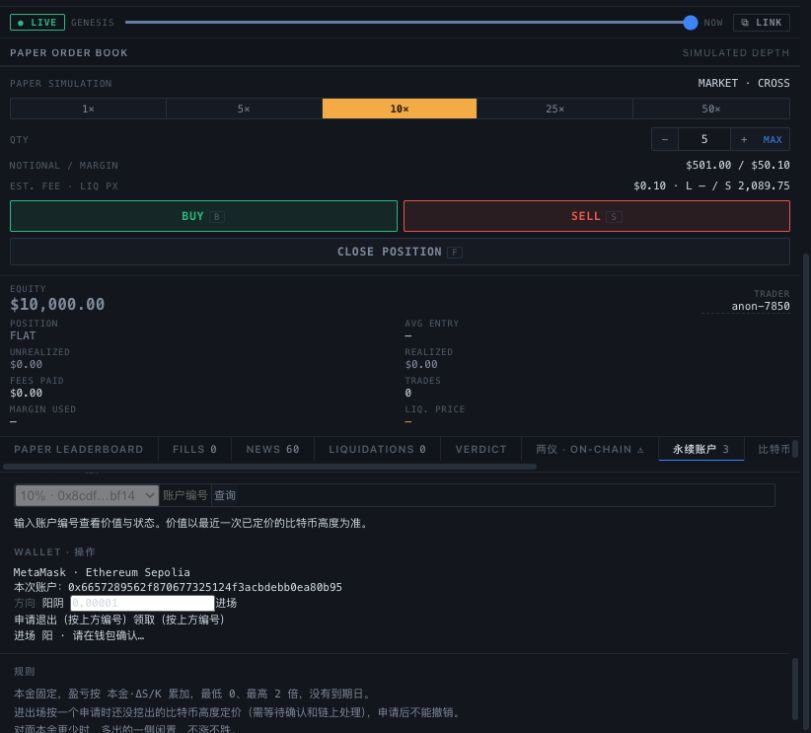

# MetaMask 进场 gas 修复 · 2026-10-18

## 根因与证据

失败交易 0x3195b840a9c1f7cba06e6037de3947ad2e4ad4b2d09495ab502c6bae875b8209
为 EIP-7702 type 4，经 DelegationManager 包装调用 requestEnter。
完整本地重放（先执行同块前序交易）在 WETH transferFrom 成功后、池内写状态期间 OutOfGas，
层层回滚。重放 gasUsed=1233602，与真实回执完全一致；不能用“gasUsed 小于总 gasLimit”排除内层耗尽，
因为调用转发和回滚后的记账/退款会影响外层用量。

原上限 1659180；在相同前一区块分叉、相同时间戳、原授权及其余交易字段下：

| gasLimit | 状态 | gasUsed | EnterRequested |
|---:|---|---:|---|
| 1659180 | 回滚 | 1233602 | 无 |
| 2737148 | 成功 | 1451596 | 本地账户 3，正确 owner、阳方向 |

对照只改变 gasLimit，没有修改池子或代币、余额与授权。分叉成功不计作公共 Sepolia 建仓成功。
原始证据：[完整重放](../../contracts/deployments/t13-metamask-entry-replay-2026-10-18.txt)、
[快速重放](../../contracts/deployments/t13-metamask-entry-quick-replay-2026-10-18.txt)、
[本地分叉对照收据](../../contracts/deployments/t13-metamask-gas-replay-2026-10-18.json)。
包装地址的公开验证源码来自 Sourcify v2，exact_match；没有引入其源码作为项目依赖。

## 修复

网页在模拟成功后取得直接调用的 eth_estimateGas，并识别当前账户的 EIP-7702 delegation indicator。
普通账户预留 25%；delegated 账户使用 estimate*2+500000，为包装的授权和 hooks 留余量。
本例直接估值 1118574，得到 2737148。预算超过 5000000 gas 或估值异常则停止。
提交显式 gas 前再次核对链、provider 选中账户、应用账户与池子。
不改 gas 单价、钱包设置或 delegation；实际费用仍由用户在钱包确认，未用 gas 不收费。
此余量是本例验证过的预算，不保证任意钱包包装都足够；真实交易必须再核对上限与回执。

56 项前端回归通过，包含 delegated 预算和过高估值阻止发送；三池实时发布核验通过。
HTML 已同步至 localhost:8796。没有改合约或重新部署。

## 真实复验交接

由于上次失败消耗 gas，原余额 0.0029576749782152 ETH。
再补 0.003 Sepolia ETH，确认余额 0.0059576749782152 ETH；本轮累计 gas 补给 0.008 ETH。
[本次补给交易与收据](../../contracts/deployments/t13-metamask-retry-fuel-2026-10-18.json)；无主网资金。
网页已重新连接同一 0x6657…0B95 / Sepolia，10% 池，阳，0.00001 WETH，复用已有精确授权。
仅发起一次进场，等待用户在钱包签名。公共链成功与否及实际 gasLimit 待补，暂不标记真人验收 PASS。

## 本地复现

启动仅监听 127.0.0.1:18547 的 Anvil，chainId 11155111，forkBlock 11938380，accounts 0，
使用 --no-bal --no-fork-node-info --fork-state-by-number；随后运行
scripts/replay-metamask-entry-gas.mjs。脚本固定 loopback RPC、检查初始高度，仅本地 impersonation；
没有私钥，也不向公共 RPC 广播。

