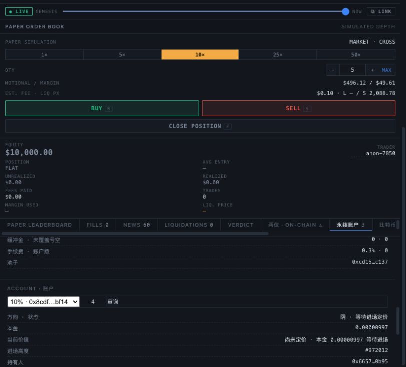

# 当前 v3 源码整合与配对验收 · 2026-10-18

main 已整合 codex/fix-mtp-window 至 bd81100，保留 main 的 EIP-6963、钱包白名单、gas 预算与真实交易记录。
合并前 main=6706203，共同祖先 d443528；唯一人工冲突为架构文档，保留双方规则并纠正旧状态。
本轮没有重新部署合约，没有切换运行中的 keeper/indexer，也没有合入项目秘密配置。

## 候选版本核验

- 325 项 Foundry 测试通过，0 失败；24 项完整历史回放按默认开关跳过，未计作已完成。
- Node/终端共 191 项：190 通过，0 失败，1 跳过。
- 原 invariant 配置 runs=64、depth=60、fail_on_revert=true 保持不变。
  合入的偿付断言从“余额加坏账和未退休负值覆盖负债”改为实际余额覆盖，
  另显式保护 pendingPrincipal、refundReserve、reservedClaims；没有为通过测试削弱资金要求。
- 四个核心源码文件逐字节等于部署来源 03f6256。
- 全新编译并核对 9 个链上对象：指数、奖励、路由、工厂、三个池、两段 creation-code 数据。
  运行时代码包含 compiler metadata，只屏蔽编译器声明的 immutable 槽；两段 STOP 数据拼回的
  creation code 与新编译结果完整相同。实际 immutable 参数仍应结合部署绑定和钱包发送前核验理解。
- operator 冻结快照的 24 个文件 SHA-256 全部不变。

| 生产合约 | runtime 字节 |
|---|---:|
| WujiAccounts | 23646 |
| WujiAccountsFactory | 2425 |
| WujiHeaderIndex | 12234 |
| ZkWujiIndex | 22074 |

均低于 EIP-170 的 24576 字节；WujiAccounts 仅剩 930 字节空间。

原始记录：[字节码/源码/快照](../../contracts/deployments/t13-integration-verification-2026-10-18.json)、
[Foundry](../../contracts/deployments/t13-integration-forge-2026-10-18.txt)、
[Node](../../contracts/deployments/t13-integration-node-2026-10-18.txt)、
[构建与尺寸](../../contracts/deployments/t13-integration-sizes-2026-10-18.txt)。
测试与编译使用 /tmp 下全新目录，避免沿用工作目录已有产物。

## 编译元数据的复现

最初按历史 remappings-v3.json 重编，指数仅有末尾元数据的 32 字节哈希不同，未宣告通过。
实际 header-v3 部署的 compiler input 包含原 worktree 的绝对 context。
现将这组设置单独记录在 contracts/remappings-header-v3.json，保留历史 v3 的原配置。
build-reproducible.mjs 新增可选第三参数，使用指定的 literal remappings 重新运行原生 solc，
不事后修改或删除 metadata。相同部署可在其他 checkout 复编，不要求原路径存在。

复验顺序：全新目录 forge build --offline --build-info --skip test --skip script，
再运行 build-reproducible.mjs ROOT OUT contracts/remappings-header-v3.json，
最后运行 verify-header-release.mjs OUT。后者只读 Sepolia，不签名。
这是历史部署复现配置，不意味未来部署应继续引入新的绝对工作目录。

## 真实配对进场

用户 MetaMask / 0x6657…0B95 / Sepolia / 10% 池：

| 账户 | 方向 | 投入 WETH | 净本金 WETH | 定价高度 | 状态 |
|---|---|---|---|---|---|
| 3 | 阳 | 0.00001 | 0.00000997 | 972012 | entering |
| 4 | 阴 | 0.00001 | 0.00000997 | 972012 | entering |

阴侧授权 0x96ea5271dbf50217cc6cdf00939d03b170c2f07a62c9af0d42d627b64a2ec043；
进场 0x4fd3295b0751c99a19fc29875cdce3542e9be4cee6f3e03e89fd7c61060e6819。
收据成功、owner/方向/净本金/定价高度、规范块与代币余额已核对。
同块池余额 0.00002 WETH = 待入场本金 0.00001994 + buffer 手续费 0.00000006；
refundReserve、reservedClaims、badDebt 均为 0。钱包本轮补给的 WETH 已全部用于两侧，没有继续加仓。
[阴侧原始交易与资金对账](../../contracts/deployments/t13-metamask-yin-success-2026-10-18.json)。

## 待完成与运行边界

两笔进场均成功，尚未定价；等高度 972012、K=100 和链上处理后再申请退出和领取。
不会为加快验收降低确认深度或改定价规则。真实拒签项、首次 type-4 gas 路径仍单独 OPEN。
后台同高 S 对账一致；keeper 按 100 确认加最少 36 个可折叠高度批处理，
“119/120 headers past”尚未达到 136 头门槛，不直接认定停摆。
日志仍有间歇 RPC fetch 失败；本轮未声称长期运行已验收，也未在此切换服务配置。
独立审计、第二台机器接手及主网经济可持续性仍未完成。这次合入不是新的安全审计结论。

