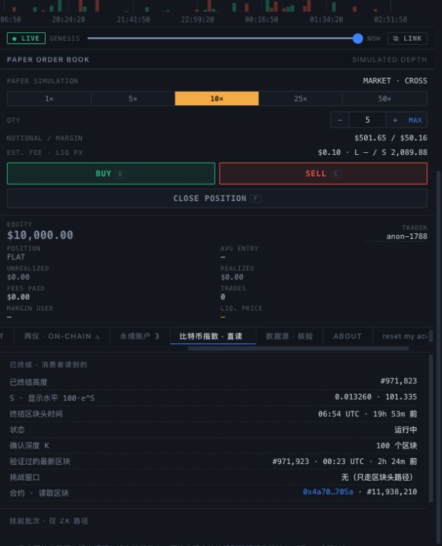

# Sepolia v3 后台恢复与完整往返复验 · 2026-10-18

当前 v3 后台与同高指数核验通过；10% 池的既有完整链上往返复验通过。该往返由加密测试钱包于
10 月 12–15 日完成，本次核查其实际收据，没有重复进场。MetaMask 的真人界面验收仍单独待做。

## 当前版本与后台

- 实际工作目录为 `/Users/m/Documents/Codex/2026-10-11/ya/work/wuji-mtp-fix`，
  当前主目录 `main` 仍是旧源码。v3 部署源码为 `03f6256`；operator 冻结运行快照记录为 `193269d`。
  该分支包含 MTP 顺序窗口修复、退出款准备金与分段重组证明，不可用旧 checkout 代表新部署。
- 指数 `0x4a70Ebc03DA98f04d88964E17dF212ba1bb2705a`；10% 池
  `0x8cdf42009548483f25fe4bcd6ac00bbb88e2bf14`。
  [公开部署清单](../../contracts/deployments/sepolia-header-v3.json) 已同步到本 checkout。
- 新版 keeper 原本就在运行：`com.wuji.sepolia-header-v3-keeper`，独立运行账户 `0x27b2…dcD2`。
  间歇性的 peer 无响应和 RPC fetch 错误仍见于日志；进程继续重试，不把进程存活本身当成指数一致证据。
- 恢复 `http://localhost:8796/`，只读 indexer 使用 v3 冻结运行文件及对应 terminal 快照，
  核对 indexer 文件哈希后启动。新增 `com.wuji.sepolia-header-v3-indexer` LaunchAgent，登录后启动、异常退出自动重启。
  原先仅有 keeper/lifecycle 服务，没有前台 indexer。
- 只读 indexer 采用现有 HTTP 来源；keeper 保留自身 P2P 来源。两者缓存分开。
  初次恢复时 P2P 前台等待多个无响应 peer，改用现有 HTTP 来源后同步正常。
- 重复执行 `bash scripts/header-testnet.sh` 不创建第二个服务。已主动结束一次 indexer，确认 launchd
  启动新进程、API 恢复、三个池与同高对账再次有效。没有重启现有 v2/v3 keeper，没有部署合约。

## 指数复验

[原始证据](../../contracts/deployments/t13-reconciliation-2026-10-18.json)：EVM `0xb6298b`，
Bitcoin **971823**，从原 anchor **969545** 起逐头重算至该高度，并检查之后 100 个后继链接：

| 项目 | 结果 |
|---|---|
| U | 1105 |
| 链上 S / 重算 S（wad） | **13260000000000000 / 13260000000000000** |
| 最终哈希 | `00000000000000000001d50357c845a25282d010bf47d4391c0886dec6b6a6f0` |
| mempool.space / Blockstream 同高哈希 | 均相同 |
| K / frozen | 100 / false |

`scripts/verify-header-index.mjs` 不读取 indexer 的累计 U 缓存，直接重算本地 P2P 原始头；固定所有 EVM
读取并复查块哈希。修改一字节的临时头文件被拒绝。此项是作者运行的复验，并非第三方审计或完整节点验证。
[API 快照](../../contracts/deployments/t13-indexer-snapshot-2026-10-18.json) 另保存 indexer 的同高一致结果。
图表的六确认观察路径与合约的 100 确认结算高度不同，不能直接比较两个不同高度的显示水平。

## 完整链上往返：通过

[重新取得的九笔交易与原始收据](../../contracts/deployments/t13-roundtrip-verified-2026-10-18.json)。
PublicNode 本次查询旧交易回执返回 null；改用 Tenderly 公共 Sepolia RPC，并核对链号、每笔交易 calldata、
收发地址、金额、规范块哈希和 finalized 高度。没有将本地 `phase=complete` 单独当作完成证据。

专用测试钱包 `0x1405D3d3f81F507be2315BF4708Fc9444BBbca3f` 完成：包裹测试 ETH、精确授权、
阳/阴各进场一次、入场定价、分别申请退出、退出定价、分别领取、解包返还的 WETH。
入场 epoch **971160**，退出 epoch **971436**，原完成时间 **2026-10-15 20:43:48 北京时间**。

| 项目 | wei |
|---|---:|
| 总存入 | 20000000000000 |
| 两侧合计入场费 | 60000000000 |
| 两侧合计退出费 | 59820000000 |
| #1 实收 | 9957266475520 |
| #2 实收 | 9922913524480 |
| 合计返还并解包 | **19880180000000** |

实际返还为 **0.00001988018 测试 ETH**，等于存入扣除上述费用。每笔领取同时匹配对应 ID/持有人的
`Claimed` 与 WETH `Transfer` 事件，并等于领取前固定块的 `claimableOf`；不能仅靠钱包总余额变化认定到账。
复验块 `0xb62995` 下，两账户已关闭，`openAccounts/reservedClaims/pendingPrincipal/refundReserve/badDebt` 均为 0。

- [#1 领取](https://sepolia.etherscan.io/tx/0xb4ec7c30578c6c9d86ca567094f5e9449632ef76f0d09afe767a2691dad73bf8)
- [#2 领取](https://sepolia.etherscan.io/tx/0xdcec555ca35342f7330fa09ea7f4706a0ff0ae21c297ee822cbe19eea7ac73f2)
- [解包](https://sepolia.etherscan.io/tx/0xd31528d0c4f568fb25fdcb7060129427e6bc7f8667905e5fbe07aa92d45842a9)

重复复验入口：`node scripts/verify-header-roundtrip.mjs`，只读，不签名、不重复交易。
原 runner 的四项锁/收款验证测试通过；原 keeper/accounts 相关 11 项测试通过。

## 恢复中的纠正与资金记录

起初只按主目录旧清单判断后台停止，曾启动旧版只读 indexer/keeper；旧 keeper 报 gas 不足后，向它补给
0.02 测试 ETH。随后发现另一个 worktree 的新版 operator，立即停止本次启动的旧服务，未向旧池发送进退场交易。
0.02 测试 ETH 已完整退回原部署钱包；两笔内部转账收据均保留，gas 合计 **2100000399000 wei**，只消耗测试 ETH。
此前“核心开发停留在 10 月 5 日、当前没有 keeper、完整往返尚未完成”的判断不适用于新版 v3，应以本报告为准。

- [补给收据](../../contracts/deployments/t13-keeper-fuel-2026-10-18.json)
- [退回收据](../../contracts/deployments/t13-keeper-fuel-return-2026-10-18.json)

## 尚未验收的范围

当前前台可读 v3 指数、三个池和已关闭的账户；v3 池尚未列入网页钱包的发布白名单，页面明确保持只读。
“数据源”中的旧金库核验也不能拿来验证 v3 无金库指数，应查看“比特币指数 · 直读”标签与上述独立重算结果。
本次不把加密钱包协议往返写成 MetaMask 真人完整流程通过；网页接入 v3、签名拒绝/错链等交互仍需单独验收。
没有主网上线或独立审计结论。

