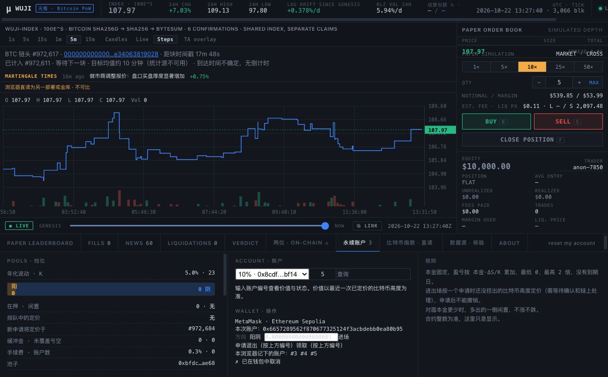

# 真人钱包边界验收 · 2026-10-22

当前结果：**真人拒签 PASS，取消后重试并再次拒签 PASS；首次 type-4 仍 OPEN。**
Chrome `localhost:8796`，MetaMask、Sepolia 11155111，10% 池
`0x8cdf42009548483f25fe4bcd6ac00bbb88e2bf14`；账户 `0x6657289562f870677325124f3acbdebb0ea80b95`。
工具只操作项目网页，钱包扩展由用户操作，没有绕过此前的钱包自动操作限制。

## 已完成的真人拒签与重试

本次最终用 **1 wei WETH** 的精确授权作为请求。用户明确两次点「拒绝/取消」。
第一次页面显示 `✗ 已在钱包中取消`，池选择、方向和操作按钮恢复。
不刷新页面重试，真实钱包再次收到相同请求；用户再次拒绝，页面再次恢复。
两次之间及之后的规范块快照核对：

| 字段 | 拒绝前与两次拒绝后 |
|---|---|
| latest / pending nonce | 12 / 12 |
| Sepolia ETH | 2182842410466875 wei |
| WETH | 18880180000000 wei |
| allowance | 0 |
| 池 nextId | 6 |
| delegation code | 不变 |

用户操作、真实页面提示和链上不变三者一起作为证据，不以单独 nonce 未变推定真人拒签。
这两次拒绝没有新增交易或 gas 支出；**本轮其他准备动作有实际测试 gas 成本**，见下节。
页面退出确认也做了「打开 #4 → 取消 → 再打开 → 再取消」，没有提交确认；该项单列为浏览器流程，
不冒充真人钱包的第三次拒签，也不尝试重复退出已经结清的 #4。

[原始快照与核对账本](../../contracts/deployments/t13-wallet-ui-boundaries-2026-10-22.json)

## 首轮实际确认与新增账户 #5

原先准备拒绝的 0.000001 WETH 授权实际上成功上链，随后进场请求返回 gas 不足。
用户确认没有看到该进场请求；不能将此算作拒签。
从既有部署测试账户补 **0.003 Sepolia ETH** 后重试进场，用户反馈误点确认。
立即停止重复请求并核对：实际成功创建 **#5 阳**，投入 1000000000000 wei WETH，
入场费 3000000000 wei，净本金 997000000000 wei，待 **972684** 定价。
交易是 **type 2**，不是首次 type-4 证据。

- [首轮授权原始收据](../../contracts/deployments/t13-wallet-ui-attempt-1-2026-10-22.json)
- [测试 gas 补给与核对](../../contracts/deployments/t13-wallet-ui-gas-2026-10-22.json)
- [#5 进场收据、Transfer 与状态](../../contracts/deployments/t13-wallet-ui-entry-5-2026-10-22.json)

已核对 ETH：初始余额 + 补给 − 授权 gas − 进场 gas = 最终余额；
WETH：初始余额 − 本次投入 = 最终余额。测试 gas 与 WETH/合约费用分列，未操作主网。
拒签测试随后改为 1 wei 授权；即使误确认，合约对 amount=1 的入场会因向上取整费用等于本金而拒绝，
不会创建另一个仓位。它仍可能浪费一次授权 gas，因此继续要求用户明确拒绝。
**#5 后续仍须等待入场定价、申请退出、退出定价并领取，不能把此前 #3/#4 往返报告当作 #5 已结清。**

## 首次 type-4 的真实验收条件

0B95 已是 `0xef0100…` delegated 账户，不能用它的下一笔 type 2 包装交易替代首次升级。
未撤销其 delegation、未清空其状态、未导入项目 keystore。
已请用户创建并连接一个只供 Sepolia 的新测试账户，先不升级或发送，待核对公开地址、链号和 `eth_getCode=0x`。
新账户尚未连接或未得到可核对地址时，此项保持 OPEN，不能自动换一个项目签名账户计作真人验收。

需要保留：升级前规范块与账户 code、真实 type `0x4` 与 authorizationList、成功回执及规范块、
升级后 code、实际 gasLimit/gasUsed、预期合约事件和金额。
若 type 4 仅为升级/授权，而进场另是 type 2，应分别记录，不能声称已验证「首次 type-4 内进场」。
普通授权可能先升级钱包，因此先检查真实钱包流程，再决定如何覆盖原失败的入口。
根据 [EIP-7702](https://eips.ethereum.org/EIPS/eip-7702)，执行回滚不会撤销已经处理的 delegation，
失败后不可直接把同一个已升级账户称为首次升级复测。
MetaMask 的升级与恢复步骤见[官方说明](https://support.metamask.io/configure/accounts/switch-to-or-revert-from-a-smart-account)。

## 工具与验证

- `scripts/check-wallet-ui-state.mjs ADDRESS NEW_OUTPUT`：规范块只读快照，拒绝覆盖已有输出。
- `scripts/check-wallet-ui-entry.mjs`：核对本次唯一新增的 #5 收据、Transfer 与账户状态，不发送交易。
- `scripts/fund-wallet-ui-gas.mjs`：本轮单次、固定收付款地址、仅 Sepolia、0.003 ETH 上限，
  检查双方 pending nonce，广播前写意图；已有日志或不确定发送必须人工核对，禁止重复发送。
  使用现有加密 keystore，密钥不上命令行或日志；没有通过它代签 MetaMask 钱包交易。
- 全部终端回归 **62 通过、0 失败**；默认 Forge **325 通过、0 失败、24 跳过**，
  本轮未开启全历史回放。重复 gas 补给的日志保护也已验证，未再次发送。
  没有修改生产 HTML、合约或正在运行的后台。
