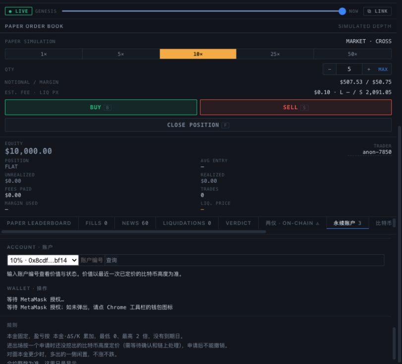
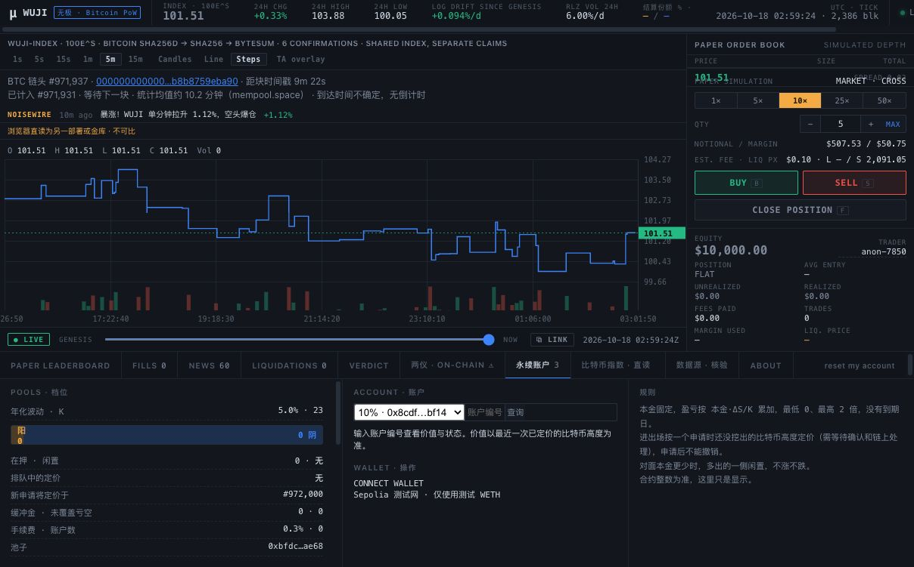

# Sepolia v3 网页钱包接入 · 2026-10-18

v3 的 5% / 10% / 25% 三个池已接入本地终端钱包；代码回归与实时部署核验通过。
Chrome 已选中 10% 池并发起 MetaMask 连接请求，等待用户连接测试钱包。真人签名流程尚未通过，
不能用此前加密钱包的协议往返或本次测试替身结果代替真人验收。

## “没有弹窗”的修复

用户反馈没有弹窗。Chrome 页面的开发日志显示 MetaMask 设置全局 provider 失败：
另一个扩展已将 `window.ethereum` 设置为只有 getter 的属性。此前页面同时显示 `User rejected the request.`，
这不能证明用户主动拒绝，更不能证明连接请求发给了 MetaMask。

现按 [EIP-6963](https://eips.ethereum.org/EIPS/eip-6963) 的 request/announce 事件发现钱包，
“连接 MetaMask”优先路由到声明为 `io.metamask` 的 provider，发现其他钱包时不静默改连它们。
声明来自扩展本身，不把名称或 rdns 当作钱包身份认证。旧钱包回退只用于发现机制无结果时，
MetaMask 专用入口不会回退到自称其他钱包的默认 provider。
连接过程中显示授权等待、阻止重复点击；拒绝和已有请求改为中文指引。连接后固定 provider，
后来的扩展公告不替换当前连接，旧 provider 的事件也不能改动当前账户。

新增 8 项钱包发现回归，总计 **54 项通过**。Chrome 已重新发起请求，实际显示
“等待 MetaMask 授权；如未弹出，请点 Chrome 工具栏的钱包图标”。尚未取得地址，没有新交易。
工具不操作钱包扩展页面；需要用户手动打开 MetaMask，查看授权或解锁。

## 改动与核验

- 页面单独内置 v3 永续池清单，地址来自 `sepolia-header-v3.json`；代码 SHA-256 来自修复分支
  10 月 12 日逐字节部署核验记录。本次重新从 Sepolia 获取代码、参数，三个池均一致。
- 网页签名前固定一个距当前时间不超过 120 秒的 EVM 块，检查池子的抵押品、K、index、treasury、
  手续费及指数 K=100，核对池和指数的完整代码 SHA-256，再复查块哈希。
  钱包选中账户、应用账户、池子或网络中途改变时停止后续交易。
- 进场前检查当前是否接受新申请、代币余额及 allowance；不足则在钱包提示前报错。
  授权金额仅为本次输入数量，授权后再重新核验并模拟进场。进场预检查有并发锁，连续点击不重复提交。
- 退出、领取也先模拟，再请求签名；重复退出、尚不可领取、非持有人及分批结算提示有中文说明。
  拒签显示“已在钱包中取消”，并释放 busy 状态。等待回执期间继续核对钱包链号。
- 采用修复分支的冻结/分批结算显示，指数直读指向 v3；去掉“约 1–4 小时”保证式提示，改为说明
  未来 Bitcoin 高度、确认深度与链上处理决定等待时间。
- `scripts/header-testnet.sh` 原子同步已提交的 HTML 到只读 indexer 的静态目录，避免改了源文件却仍服务旧页面。
  keeper 的冻结运行文件及其哈希保持不变。

实时读链使用浏览器同一段核验函数：
`node scripts/verify-perp-release.mjs`。它用本地虚拟账户上下文测试核验函数，所有链上读取是真实 RPC，
没有钱包连接、签名或交易。三个池的代码指纹与绑定通过，详见
[原始实时证据](../../contracts/deployments/t13-wallet-release-2026-10-18.json)。
本地 HTTP 返回的 HTML 已逐字节与源文件比较相同。

## 回归结果

运行 `node --test apps/terminal/*.test.mjs`，共 **46 项通过**。
本次新增 22 项，用实际单文件钱包函数及 EIP-1193 测试替身覆盖：

- 精确授权后进场、按选中 ID 退出和领取、链号参数及固定块读取；
- 0 / abc / 负数、余额不足、错链、过时区块、EVM 重组；
- 错误代码、错误指数绑定、不接受申请、未发布池；
- 拒签、授权后切换账户或网络、并发点击；
- 重复退出、提前领取、非持有人和分批结算拒绝。

旧终端 24 项核验/钱包测试继续通过。没有改合约或再次部署，没有用自动化模拟结果声称真实签名通过。

## 真人验收的交接点

Chrome 页面 `http://localhost:8796/` → 永续账户 → **10% · 0x8cdf…bf14**，已点击 CONNECT WALLET。
内置浏览器实际显示 `No wallet found. Install MetaMask.`，因此改在 Chrome 准备真人流程。
钱包扩展授权及签名由用户操作，不导入项目 keystore，不要求种子或私钥。

下一步先连接用户的测试钱包，核对 Sepolia、测试 ETH/WETH 余额；如需测试代币补给，先以实际钱包地址为准。
随后先做拒签和错误输入，再用极小测试金额进场，记录真实交易和未来定价高度。
所有界面动作是否通过、签名是否发出、是否到账必须分别记录。实际等待可能跨天。
既有加密钱包完整往返的链上复验见 [运行报告](T13_RUNTIME_2026-10-18.md)。

